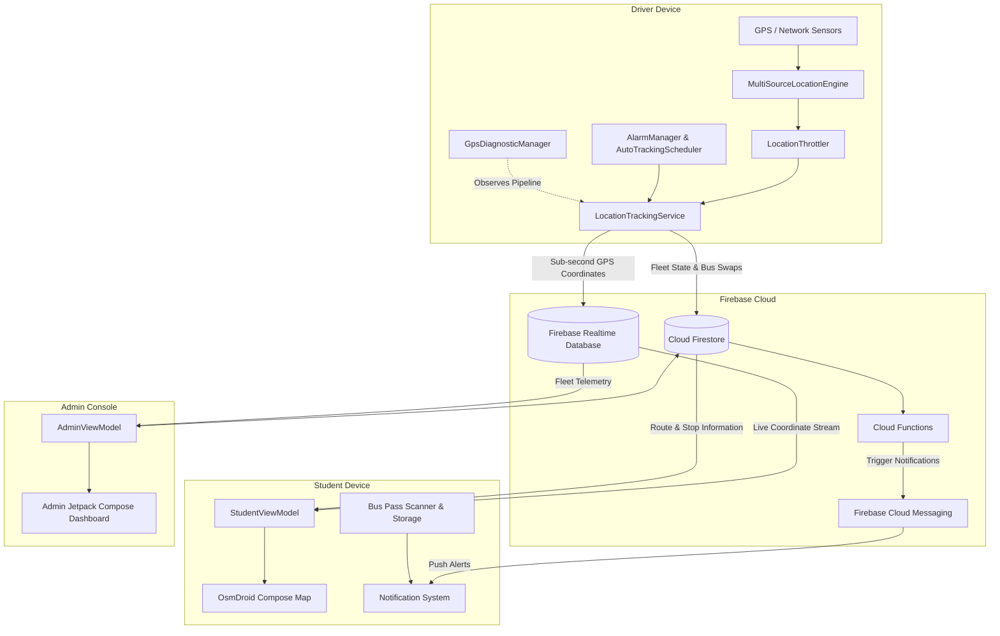
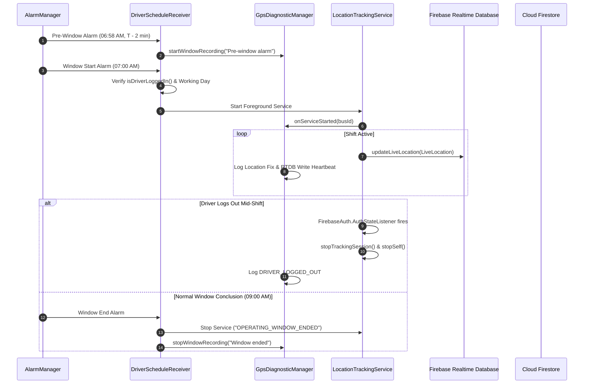
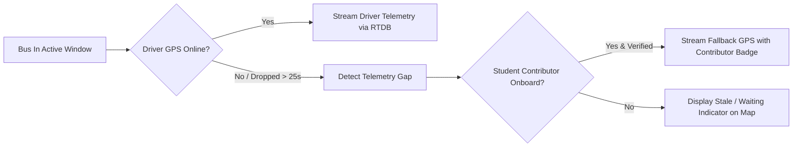

# FleetX — Real-Time College Bus Tracking & Fleet Management

[](https://github.com/bkeshava636-dot/FleetX/releases/latest)

[](https://kotlinlang.org)
[](https://developer.android.com)
[](https://developer.android.com/jetpack/compose)
[](https://firebase.google.com)
[](https://github.com/osmdroid/osmdroid)
[](https://github.com/bkeshava636-dot/FleetX/releases/latest)
[](LICENSE)

**FleetX** is a modern, battery-efficient, and enterprise-grade college bus tracking and fleet management ecosystem built natively for Android. Designed specifically for higher education transit networks, FleetX connects students, drivers, and campus transportation administrators through real-time telemetry, automated schedule synchronization, digital bus pass scanning with on-device computer vision, and continuous background GPS diagnostics.

---

## Table of Contents
- [Overview](#overview)
- [Key Features](#key-features)
  - [1. Student Experience](#1-student-experience)
  - [2. Digital Bus Pass Scanner & On-Device Vision](#2-digital-bus-pass-scanner--on-device-vision)
  - [3. Driver System & Automated Telemetry](#3-driver-system--automated-telemetry)
  - [4. Background GPS Diagnoser & Health Monitor](#4-background-gps-diagnoser--health-monitor)
  - [5. Admin Command Center](#5-admin-command-center)
  - [6. Bilingual Support: Kannada & English](#6-bilingual-support-kannada-ಕನ್ನಡ--english)
  - [7. Campus Announcements & Bus Timing Alerts](#7-campus-announcements--bus-timing-alerts)
  - [8. Core Infrastructure & Resilience](#8-core-infrastructure--resilience)
- [System Architecture](#system-architecture)
  - [High-Level Data Flow](#high-level-data-flow)
  - [Automated Schedule & Telemetry Lifecycle](#automated-schedule--telemetry-lifecycle)
  - [Dynamic Fallback & Student Crowdsourcing](#dynamic-fallback--student-crowdsourcing)
- [Tech Stack](#tech-stack)
  - [Mobile Application](#mobile-application)
  - [Cloud Backend](#cloud-backend)
- [Project Structure](#project-structure)
- [Getting Started & Development Setup](#getting-started--development-setup)
  - [Prerequisites](#prerequisites)
  - [Step-by-Step Setup](#step-by-step-setup)
  - [Firebase Configuration](#firebase-configuration)
- [Building & Installing](#building--installing)
- [Android Permissions & Battery Optimization](#android-permissions--battery-optimization)
- [Privacy & Security](#privacy--security)
- [Automated Testing](#automated-testing)
- [License](#license)

---

## Overview

University transit systems often struggle with irregular arrival times, lack of driver accountability, unexpected bus substitutions, and student frustration at stops in harsh weather. Proprietary hardware GPS trackers are costly to buy, install, and service across large fleets.

**FleetX** replaces costly dedicated hardware by pairing standard driver smartphones with an ultra-reliable background location engine, Firebase Realtime Database for sub-second telemetry, and OpenStreetMap (OsmDroid) for zero-cost mapping.

### Why FleetX?
* **Zero Hardware Installation:** Operates directly on drivers' existing Android phones.
* **Cost-Free Mapping & Geocoding:** Powered 100% by OpenStreetMap and OsmDroid—eliminating costly map SDK licensing fees.
* **Automated Shift Tracking:** Tracking activates and concludes automatically based on scheduled college hours—requiring zero driver intervention.
* **Driver Logout Safety:** When a driver signs out, background tracking and alarm timers are immediately dismantled.
* **On-Device Digital Bus Pass:** Built-in scanner with quadrilateral detection, perspective correction, and offline verification.
* **In-App GPS Diagnoser:** Dedicated background diagnostic recorder observing each stage of the GPS pipeline with root-cause synthesis.
* **Crowdsourced Redundancy:** If driver connectivity drops, verified onboard student riders can seamlessly provide crowdsourced fallback tracking.

---

## Key Features

### 1. Student Experience
* **Sub-Second Live Map:** Live bus location, bearing, speed, and status updating in real time via Firebase Realtime Database.
* **Live ETA & Distance Predictions:** Dynamic travel time calculations based on road network progress and current traffic conditions.
* **Interactive OpenStreetMap Rendering:** Custom vehicle markers (Active, Waiting, Inactive, Stale) with animated bearing rotation on OsmDroid.
* **Driver & Vehicle Details:** Immediate access to assigned driver identity, verified contact number, bus number plate, route timetable, and stops.
* **Push Notifications via FCM:** Real-time push alerts for departure, route completion, emergency delays, and bus substitution notices.
* **Crowdsourced Student Fallback:** When a driver's phone battery depletes or drops signal, onboard students can safely contribute fallback location telemetry to keep the bus visible for peers.

### 2. Digital Bus Pass Scanner & On-Device Vision
* **Automatic Card Contour Detection:** Real-time edge detection and quadrilateral boundary identification (`CardDetector`).
* **Perspective Transform & Document Deskewing:** Automatically unwarps angled card captures into clean, flat rectangular passes (`PerspectiveCorrector`).
* **Intelligent Quality Analysis:** Analyzes focus sharpness (Laplacian variance), glare saturation, and standard ID aspect ratios before saving (`QualityChecker`).
* **Manual Corner Tuning:** Interactive corner drag handles with a magnifying loupe for pixel-perfect edge refinement (`CornerAdjustmentScreen`).
* **Offline Local Storage & Duplication Guard:** Secure on-device bitmap storage and SHA-256 perceptual hashing to prevent duplicate pass registration (`BusPassStorage`, `ImageHasher`).

### 3. Driver System & Automated Telemetry
* **Automated Background Tracking:** Operates under Android `AlarmManager` exact RTC alarms. Automatically launches and terminates the foreground service aligned with morning and evening operating shifts.
* **Multi-Source Location Engine:** Seamlessly transitions between `FusedLocationProviderClient` (Google Play Services) and native Android `LocationManager` (GPS/Network) for rock-solid tracking across all OEMs.
* **Smart Throttling & Power Conservation:** Speed-aware location throttling (`LocationThrottler`) minimizes battery drain while retaining smooth vehicle animations.
* **Strict Driver Logout Safety:**
  * **Complete Teardown:** Logging out immediately cancels all scheduled `AlarmManager` alarms, dismisses persistent notifications, and terminates the foreground service.
  * **Real-Time Auth Watcher:** `FirebaseAuth.AuthStateListener` inside `LocationTrackingService` instantly terminates tracking if credentials are invalidated.
  * **Boot & Receiver Guards:** Prevents background receivers from starting tracking on unauthenticated devices.
* **Bus Substitution Workflow:** Allows drivers to request or activate temporary bus substitutions during vehicle maintenance, updating student routes with zero downtime.

### 4. Background GPS Diagnoser & Health Monitor
* **Chain-of-Custody Diagnostic Engine:** Observes and records every stage in the tracking pipeline:
  $$\text{Operating Schedule} \longrightarrow \text{Alarm Fired} \longrightarrow \text{Permissions} \longrightarrow \text{GPS Hardware} \longrightarrow \text{Foreground Service} \longrightarrow \text{Location Fix} \longrightarrow \text{RTDB Write}$$
* **Window-Scoped Lead-in Scheduling ($T - 2\text{ min}$):** Automatically arms 2 minutes before shift start (e.g., `06:58` for `07:00`) to observe pre-flight conditions, wake locks, and cold-start latency.
* **Storage Conservation:** Recording halts automatically when the shift window ends, preventing 24/7 disk logging and zero writes outside shift hours.
* **In-App Diagnostic HUD:** Real-time pipeline status cards, root cause synthesis modal, daily JSONL timeline viewer, and one-click zip export.
* **RTDB Write Resilience:** Bounded exponential backoff retry (1s, 2s, 4s, max 3 attempts) for transient network drops with monotonicity checks to discard stale updates.

### 5. Admin Command Center
* **Live Fleet Monitoring:** Unified campus-wide map view displaying all operational, standby, and out-of-service buses.
* **Interactive Route & Stop Creator:** Point-and-click route creation with OpenStreetMap reverse geocoding to define geofenced stops and sequences.
* **Driver Profile Management:** Full profile management, bus assignments, and license record validation.
* **Institutional Calendar Management:** Configure working days, college holidays, special schedules, and exam timings with automatic calendar synchronization.
* **Stop Approval Requests:** Review and approve student requests for new bus stop locations.

### 6. Bilingual Support: Kannada (ಕನ್ನಡ) & English
* **Complete App-Wide Localization:** Seamless English and Kannada translation across all Student, Driver, and Administrator flows.
* **Instant In-App Language Switcher:** Switch between English and ಕನ್ನಡ at any time via header quick-actions or Settings without altering the device's system language or restarting the application.
* **Persistent & Privacy-First:** Stores the user's language preference locally via `SharedPreferences`, instantly restoring it across app launches without requiring user authentication.

### 7. Campus Announcements & Bus Timing Alerts
* **Admin Publishing Hub:** Create, edit, schedule, expire, and prioritize (`NORMAL`, `IMPORTANT`, `URGENT`) notices across 8 distinct categories (`TIMING_CHANGE`, `BUS_DELAY`, `BUS_CANCELLATION`, `ROUTE_CHANGE`, `BUS_SWAP`, `HOLIDAY`, `EMERGENCY`, `GENERAL`).
* **Audience-Targeted Distribution:** Target notices specifically to `All`, `Students Only`, `Drivers Only`, a `Selected Bus`, a `Selected Route`, or a `Selected Stop`.
* **Dedicated Bus Timing Change Workflow:** Structured dialog enabling transport managers to communicate revised departure/arrival times with bilingual previews, decoupled from operational schedule databases to preserve existing automated alarm configurations.
* **In-App Feeds & Push Alerts:** High-priority FCM push notifications formatted in the recipient's chosen language, paired with unread indicators and detail modal views for students and drivers.

### 8. Core Infrastructure & Resilience
* **Dual Firebase Architecture:** Cloud Firestore manages relational schemas (Users, Routes, Bus Swaps, Calendar Exceptions) while Realtime Database handles high-throughput coordinate streams.
* **Boot Survival:** Dedicated `AutoTrackingBootReceiver` restores exact tracking timers after device reboots.
* **Crash & Interruption Auditing:** Tracks service stop reasons (`OPERATING_WINDOW_ENDED`, `USER_MANUAL_STOP`, `DRIVER_LOGGED_OUT`, `COLLEGE_HOLIDAY`, `OPERATOR_REPLACED`, etc.).

---

## System Architecture

### High-Level Data Flow



### Automated Schedule & Telemetry Lifecycle



### Dynamic Fallback & Student Crowdsourcing



---

## Tech Stack

### Mobile Application
* **Language & Runtime:** Kotlin 2.0.20, Coroutines, Flow, StateFlow, Kotlinx Serialization
* **UI Toolkit:** Jetpack Compose, Material 3, Compose Navigation, Accompanist
* **Mapping & Geolocation:** OsmDroid 6.1.18 (OpenStreetMap), Nominatim API, Android Location API, Google Play Services Location
* **On-Device Vision:** Custom Android Canvas quadrilateral warping, OpenCV-style contour analysis, Laplacian variance blur detection
* **Background Architecture:** Android Foreground Services, Exact `AlarmManager`, `BroadcastReceiver`, `WakeLock`, Partial Power Locks
* **Local Storage:** Encrypted SharedPreferences, Internal Document Storage, JSON Lines (`JSONL`) Local Storage

### Cloud Backend
* **Authentication:** Firebase Authentication (Email/Password, Staff Roles, Student Profiles)
* **Realtime Telemetry:** Firebase Realtime Database (RTDB) with sub-second writes and field-level validation rules
* **Relational Store:** Cloud Firestore (Routes, Stops, Buses, Driver Profiles, Swaps, Calendar Exceptions)
* **Serverless Functions:** Node.js 18 Firebase Cloud Functions for FCM alerts and admin password reset flows
* **Push Notifications:** Firebase Cloud Messaging (FCM) topic-based pub/sub

---

## Project Structure

```text
college_bus_tracker/
├── app/
│   ├── src/
│   │   ├── main/
│   │   │   ├── java/com/college/bustracker/
│   │   │   │   ├── data/
│   │   │   │   │   ├── model/         # Domain models (LiveLocation, Bus, Route, Stop, etc.)
│   │   │   │   │   └── repository/    # Auth, Bus, Tracking, and TemporaryAssignment repos
│   │   │   │   ├── diagnostics/       # In-App GPS Diagnostic Engine & Local Storage
│   │   │   │   │   ├── GpsDiagnosticManager.kt
│   │   │   │   │   ├── GpsDiagnosticModels.kt
│   │   │   │   │   ├── GpsDiagnosticStorage.kt
│   │   │   │   │   └── ui/GpsDiagnosticsScreen.kt
│   │   │   │   ├── pass/              # Digital Bus Pass Scanner & CV Engine
│   │   │   │   │   ├── engine/        # CardDetector, CardEnhancer, PerspectiveCorrector, QualityChecker
│   │   │   │   │   ├── model/         # BusPass, CardQuad, QualityResult
│   │   │   │   │   ├── storage/       # BusPassStorage, ImageHasher
│   │   │   │   │   └── ui/            # ScannerScreen, ReviewScreen, CornerAdjustmentScreen
│   │   │   │   ├── service/           # LocationTrackingService, AutoTrackingScheduler, Receivers
│   │   │   │   ├── ui/
│   │   │   │   │   ├── admin/         # Admin fleet monitor, route builder, approvals
│   │   │   │   │   ├── auth/          # Login, Role dispatch, Password reset
│   │   │   │   │   ├── driver/        # Driver HUD, shift controls, swap alerts
│   │   │   │   │   ├── navigation/    # AppNavHost and screen routing
│   │   │   │   │   ├── student/       # Student OsmDroid map, ETA, route search
│   │   │   │   │   └── theme/         # Color palettes, typography, theme definitions
│   │   │   │   └── util/              # MultiSourceLocationEngine, LocationThrottler, EtaEngine
│   │   │   ├── res/                   # Drawables, icons, XML provider paths, values
│   │   │   └── AndroidManifest.xml    # App manifest, service configurations, permissions
│   │   └── test/                      # 79+ Unit and regression test suites
│   └── build.gradle.kts               # Android app build configuration
├── backend/
│   ├── functions/                     # Firebase Cloud Functions (Node.js)
│   ├── firestore.rules                # Cloud Firestore role-based security rules
│   └── database.rules.json            # Firebase Realtime Database security rules
├── .gitignore                         # Secrets and build artifact exclusions
├── build.gradle.kts                   # Top-level build script
└── settings.gradle.kts                # Project module settings
```

---

## Getting Started & Development Setup

### Prerequisites
* **Android Studio:** Ladybug (2024.2.1) or newer / Hedgehog.
* **JDK:** Java 17 configured in Android Studio.
* **Android SDK:** Min SDK 26 (Android 8.0 Oreo), Target SDK 34 (Android 14).
* **Firebase Account:** A project with Authentication, Firestore, and Realtime Database enabled.

### Step-by-Step Setup

1. **Clone the repository:**
   ```bash
   git clone https://github.com/bkeshava636-dot/FleetX.git
   cd FleetX
   ```

2. **Configure Firebase:**
   * Create a project in the [Firebase Console](https://console.firebase.google.com/).
   * Register an Android application with package name `com.college.bustracker`.
   * Download `google-services.json` and place it in the `app/` folder (`app/google-services.json`).

3. **Deploy Backend Rules & Functions (Optional):**
   ```bash
   cd backend
   npm install -g firebase-tools
   firebase login
   firebase use --add <your-firebase-project-id>
   firebase deploy --only firestore:rules,database
   cd functions && npm install
   firebase deploy --only functions
   ```

4. **Open in Android Studio:**
   * Open the project root in Android Studio.
   * Allow Gradle to sync dependencies.

---

## Building & Installing

### Compile Debug APK
```bash
./gradlew assembleDebug
```
Output: `app/build/outputs/apk/debug/app-debug.apk`

### Compile Signed Release APK
```bash
./gradlew assembleRelease
```
Output: `app/build/outputs/apk/release/app-release.apk`

### Direct ADB Installation
```bash
adb install -r app/build/outputs/apk/release/app-release.apk
```

---

## Android Permissions & Battery Optimization

FleetX requests specific system permissions to maintain uninterrupted background GPS tracking:

| Permission | Purpose |
|---|---|
| `ACCESS_FINE_LOCATION` | High-accuracy GPS positioning for live telemetry. |
| `ACCESS_COARSE_LOCATION` | Fallback cell/Wi-Fi positioning for low-power tracking. |
| `ACCESS_BACKGROUND_LOCATION` | Allows tracking when the driver locks the screen or switches apps. |
| `FOREGROUND_SERVICE_LOCATION` | Complies with Android 14 requirements for active location services. |
| `POST_NOTIFICATIONS` | Displays the persistent foreground tracking notification and emergency alerts. |
| `SCHEDULE_EXACT_ALARM` | Triggers exact operating window start/stop alarms. |
| `WAKE_LOCK` | Prevents CPU sleep while transmitting live coordinates during active shifts. |
| `RECEIVE_BOOT_COMPLETED` | Reschedules automated tracking timers after a device reboot. |
| `CAMERA` | Document capture for the on-device Digital Bus Pass Scanner. |

> [!TIP]
> **Battery Optimization Exemption:** On OEM devices (Samsung OneUI, Xiaomi MIUI, Vivo FunTouch), grant battery optimization exemptions to FleetX to prevent OEM task killers from terminating the background service during active shifts.

---

## Privacy & Security

* **Zero Hardcoded Secrets:** All credentials, keys, and tokens are kept out of version control and managed securely.
* **Driver Privacy Boundary:** Telemetry is gathered **only** during active shift operating windows. The moment a driver logs out or a shift ends, all GPS processing and logging immediately terminates.
* **Role-Based Validation:** Firebase Realtime Database rules guarantee that only the authenticated driver assigned to a specific bus can write to `/live_locations/{busId}`.
* **Sanitized Diagnostics:** The diagnostic logging system strips raw coordinates, passwords, and sensitive tokens from disk logs to guarantee driver privacy.

---

## Automated Testing

FleetX maintains a comprehensive test suite covering scheduling, authentication teardowns, computer vision routines, and RTDB telemetry:

```bash
./gradlew compileDebugUnitTestKotlin
```

### Key Test Suites
* `DriverAutomaticTrackingTest`: Validates operating window evaluation, shift scheduling, and driver logout teardowns.
* `GpsDiagnosticUnitTest`: Tests pre-window lead calculations, event serialization, and diagnostic lifecycle integrity.
* `BusPassScannerTest`: Verifies card contour detection, perspective transform math, image hashing, and quality heuristics.
* `MultiSourceLocationEngineTest`: Validates fallback between Google Play Services and native GPS providers.
* `ScheduleHelperTest` & `OperatingScheduleTest`: Ensures timezone handling (Asia/Kolkata) and schedule boundary accuracy.
* `AuditBugFixAndOptimizationTest`: Verifies service cleanup on logout and security assertion compliance.

---

## License

This project is licensed under the [MIT License](LICENSE) — see the LICENSE file for details.

---

*FleetX — Built for safety, punctuality, and efficiency in campus transportation.*
