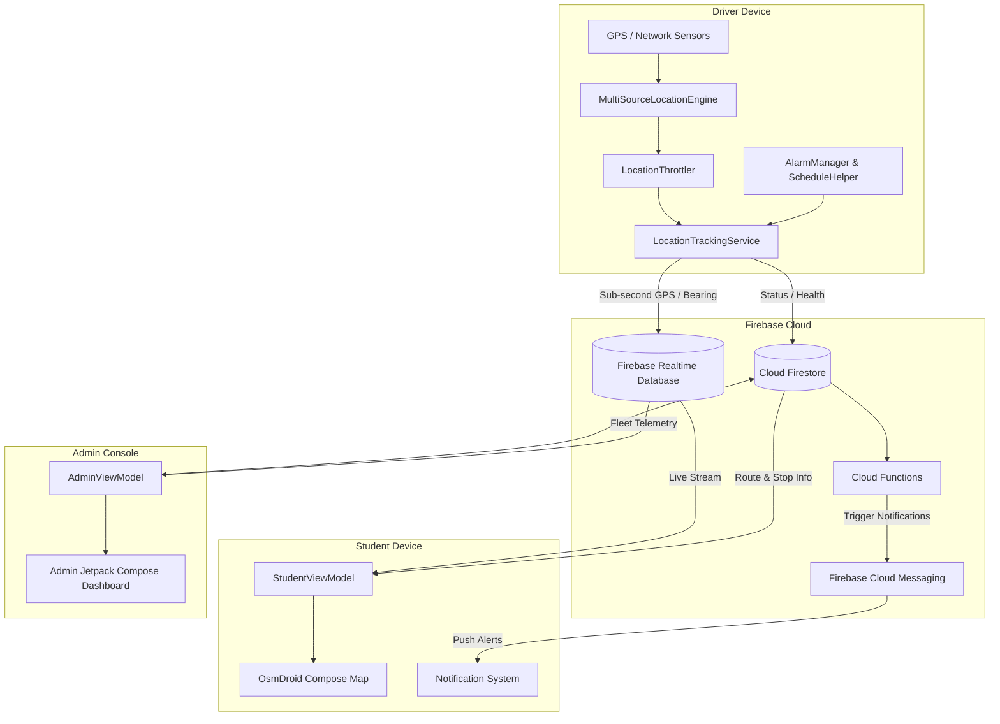
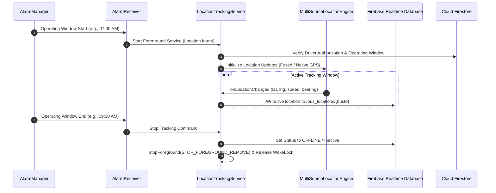
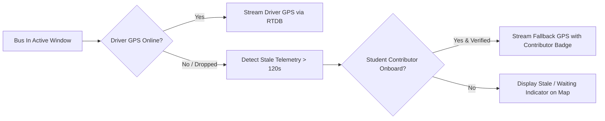

# FleetX — Real-Time College Bus Tracking & Fleet Management

[](https://kotlinlang.org)
[](https://developer.android.com)
[](https://developer.android.com/jetpack/compose)
[](https://firebase.google.com)
[](https://github.com/osmdroid/osmdroid)
[](LICENSE)

**FleetX** is a modern, battery-efficient, and enterprise-ready college bus tracking and fleet management ecosystem built natively for Android. Designed specifically for educational institutions, FleetX bridges the communication gap between students, drivers, and campus transportation administrators through seamless real-time telemetry, automated schedule synchronization, and intelligent fallback tracking.

---

## Table of Contents
- [Overview](#overview)
- [Key Features](#key-features)
  - [Student Experience](#1-student-experience)
  - [Driver System & Telemetry](#2-driver-system--telemetry)
  - [Admin Command Center](#3-admin-command-center)
  - [Core Infrastructure & Reliability](#4-core-infrastructure--reliability)
- [System Architecture](#system-architecture)
  - [High-Level Data Flow](#high-level-data-flow)
  - [Driver Tracking Lifecycle](#driver-tracking-lifecycle)
  - [Student Dynamic Fallback Tracking](#student-dynamic-fallback-tracking)
- [Tech Stack](#tech-stack)
- [Project Structure](#project-structure)
- [Getting Started & Development Setup](#getting-started--development-setup)
  - [Prerequisites](#prerequisites)
  - [Step-by-Step Setup](#step-by-step-setup)
  - [Firebase Setup](#firebase-setup)
- [Building & Installing](#building--installing)
- [Android Permissions & Battery Optimization](#android-permissions--battery-optimization)
- [Privacy & Security](#privacy--security)
- [Automated Testing](#automated-testing)
- [License](#license)

---

## Overview

University and college bus transit systems often suffer from unpredictable delays, lack of driver accountability, and poor visibility for students waiting at stops in extreme weather conditions. Proprietary hardware GPS trackers are expensive to install, maintain, and configure.

**FleetX** eliminates hardware GPS costs by leveraging modern smartphone sensors with state-of-the-art Android background location engines, Firebase Realtime Database for sub-second telemetry, and OpenStreetMap (OsmDroid) to deliver a zero-cost mapping infrastructure.

### Why FleetX?
* **Zero Hardware Costs:** Uses existing driver smartphones with automated background tracking.
* **Cost-Efficient Mapping:** 100% powered by OpenStreetMap and OsmDroid—eliminating costly map SDK billing.
* **Driver Privacy First:** Tracking runs strictly during institutional operating windows and stops automatically during off-hours.
* **High Availability:** If a driver's battery depletes or network drops, onboard student riders can seamlessly provide verified crowdsourced location updates.

---

## Key Features

### 1. Student Experience
* **Live Bus Telemetry:** Real-time bus location, speed, bearing, and operational status updating every 1–3 seconds via Firebase Realtime Database.
* **ETA & Distance Calculation:** Real-time distance and estimated time of arrival (ETA) computed dynamically for each stop along the route.
* **Interactive OpenStreetMap:** Smooth, hardware-accelerated OsmDroid map rendering with live custom bus markers (active, waiting, stale, or inactive).
* **Driver & Vehicle Details:** Instant access to assigned driver profile, phone contact, bus plate number, capacity, and current active route.
* **Push Notifications & Topic Subscriptions:** Instant alerts for route start, stop arrival, emergency delays, and bus substitutions via Firebase Cloud Messaging (FCM).
* **Crowdsourced Student Fallback:** When a bus driver goes offline during an active shift, onboard students can safely contribute fallback location telemetry to keep the bus visible for fellow students.

### 2. Driver System & Telemetry
* **Automated Background Tracking:** Foreground service driven by `AlarmManager` exact scheduling. Tracking starts and stops automatically based on configured morning and evening college operating windows—requiring zero driver interaction.
* **Multi-Source Location Engine:** Seamlessly switches between `FusedLocationProviderClient` (Google Play Services) and native Android `LocationManager` (GPS / Network providers) for maximum reliability across all OEM devices (Samsung, Xiaomi, Vivo, etc.).
* **Smart Throttling & Adaptive Battery Conservation:** Dynamic location sampling based on speed, movement thresholds, and stationary dwell detection to minimize battery drain.
* **Bus Swap & Substitute Workflow:** Enables drivers to request or activate temporary bus substitutions (e.g., in case of maintenance or breakdown) with automatic passenger stop handoffs and instant FCM notifications to affected students.
* **Manual Override Controls:** Start, pause, or end shifts manually when non-scheduled trips or emergency detours occur.

### 3. Admin Command Center
* **Live Fleet Overview:** Real-time grid and map view of all active, idle, and out-of-service buses across the campus fleet.
* **Route & Stop Management:** Interactive map-based route creator with reverse geocoding (Nominatim OpenStreetMap) to set geofenced stops, pickup sequences, and schedules.
* **Driver Profile Management:** Comprehensive CRUD operations for driver profiles, phone verification, assigned buses, and license validation.
* **Institutional Calendar Sync:** Define operating days, holidays, examination shifts, and custom operational time windows.
* **Student Stop Request Approvals:** Review and approve student requests for new campus bus stops.
* **Emergency Broadcasts & Notifications:** Send targeted or fleet-wide broadcast alerts to drivers and students.

### 4. Core Infrastructure & Reliability
* **Dual Firebase Architecture:** Cloud Firestore for relational entity state (Users, Routes, Stops, Schedules, Swap Requests) combined with Firebase Realtime Database (RTDB) for high-frequency low-latency GPS coordinates.
* **Boot Survival:** Broadcast receivers (`BootReceiver`) and `AlarmManager` restore exact tracking schedules across device reboots.
* **Network & Offline Resilience:** Automatic retry, offline caching, and graceful state degradation when cellular connectivity fluctuates.

---

## System Architecture

### High-Level Data Flow



### Driver Tracking Lifecycle



### Student Dynamic Fallback Tracking



---

## Tech Stack

| Layer | Technologies |
|---|---|
| **Language** | Kotlin 1.9.22 (Coroutines, Flow, StateFlow, Kotlinx Serialization) |
| **UI Framework** | Jetpack Compose, Material 3, Accompanist, Compose Navigation |
| **Maps & Geolocation** | OsmDroid 6.1.18 (OpenStreetMap), Nominatim API, Android Location API, Google Play Services Location |
| **Cloud & Backend** | Firebase Auth, Cloud Firestore, Firebase Realtime Database, Firebase Cloud Functions (Node.js 18), Firebase Cloud Messaging |
| **Background & OS** | Android Foreground Services, Exact AlarmManager, BroadcastReceivers, WakeLocks, WorkManager |
| **Architecture** | Modern Android Architecture (MVVM, Clean Architecture, Repository Pattern, Unidirectional Data Flow) |
| **Testing** | JUnit 4, Robolectric, MockK, Kotlinx Coroutines Test |

---

## Project Structure

```text
college_bus_tracker/
├── app/
│   ├── src/
│   │   ├── main/
│   │   │   ├── java/com/college/bustracker/
│   │   │   │   ├── data/
│   │   │   │   │   ├── model/         # Domain & data models (Bus, User, Stop, Route, etc.)
│   │   │   │   │   └── repository/    # Auth, Bus, Location, & Firestore repositories
│   │   │   │   ├── service/           # LocationTrackingService, FCM Service, BootReceiver
│   │   │   │   ├── ui/
│   │   │   │   │   ├── admin/         # Admin screens, route creation, fleet monitor
│   │   │   │   │   ├── auth/          # Login, Role dispatch, Password reset
│   │   │   │   │   ├── common/        # Shared Material3 components, dialogs, cards
│   │   │   │   │   ├── driver/        # Driver dashboard, shift swap, status controls
│   │   │   │   │   ├── navigation/    # AppNavHost and deep-link routing
│   │   │   │   │   ├── student/       # Student map, route timetable, ETA display
│   │   │   │   │   └── theme/         # Color palettes, typography, theme definitions
│   │   │   │   └── util/              # MultiSourceLocationEngine, Throttler, EtaEngine
│   │   │   ├── res/                   # Drawables, mipmaps, strings, colors, themes
│   │   │   └── AndroidManifest.xml    # App manifest, service definitions, permissions
│   │   └── test/                      # 30+ Unit and integration test suites
│   └── build.gradle.kts               # Android app build configuration
├── backend/
│   ├── functions/                     # Firebase Cloud Functions (Node.js)
│   ├── firestore.rules                # Cloud Firestore role-based security rules
│   └── database.rules.json            # Firebase Realtime Database security rules
├── docs/
│   └── INFRASTRUCTURE_AND_COSTS.md    # Cost breakdown and zero-cost scaling guide
├── .gitignore                         # Comprehensive secrets & build artifact exclusion
├── build.gradle.kts                   # Top-level build script
└── settings.gradle.kts                # Project module settings
```

---

## Getting Started & Development Setup

### Prerequisites
* **Android Studio:** Hedgehog (2023.1.1) or newer / Ladybug.
* **JDK:** Java 17 or Java 21 configured in Android Studio.
* **Android SDK:** Min SDK 26 (Android 8.0 Oreo), Target SDK 34 (Android 14).
* **Firebase Account:** A Firebase project with Authentication, Firestore, and Realtime Database enabled.

### Step-by-Step Setup

1. **Clone the repository:**
   ```bash
   git clone https://github.com/your-username/FleetX.git
   cd FleetX
   ```

2. **Configure Firebase:**
   * Create a new project in the [Firebase Console](https://console.firebase.google.com/).
   * Register an Android app with package name `com.college.bustracker`.
   * Download the generated `google-services.json` file.
   * Place `google-services.json` into the `app/` directory (`college_bus_tracker/app/google-services.json`).

3. **Deploy Backend Rules & Functions (Optional for self-hosting):**
   ```bash
   cd backend
   npm install -g firebase-tools
   firebase login
   firebase use --add <your-firebase-project-id>
   firebase deploy --only firestore:rules,database
   cd functions && npm install
   firebase deploy --only functions
   ```

4. **Open in Android Studio:**
   * Open the project root directory in Android Studio.
   * Allow Gradle to sync dependencies.

---

## Building & Installing

### Building Debug APK
```bash
./gradlew assembleDebug
```
Output: `app/build/outputs/apk/debug/app-debug.apk`

### Building Signed Release APK
```bash
./gradlew clean assembleRelease
```
Output: `app/build/outputs/apk/release/app-release.apk` (or `FleetX-v1.0.0.apk`)

### Direct ADB Installation
```bash
adb install -r app/build/outputs/apk/release/app-release.apk
```

---

## Android Permissions & Battery Optimization

FleetX requires specific system permissions to maintain uninterrupted background GPS tracking:

| Permission | Purpose |
|---|---|
| `ACCESS_FINE_LOCATION` | High-accuracy GPS positioning for live telemetry. |
| `ACCESS_COARSE_LOCATION` | Fallback cell/Wi-Fi positioning for low-power tracking. |
| `ACCESS_BACKGROUND_LOCATION` | Allows tracking when the driver locks the device or switches apps. |
| `FOREGROUND_SERVICE_LOCATION` | Complies with Android 14 requirements for active location services. |
| `POST_NOTIFICATIONS` | Displays the persistent foreground tracking notification and emergency alerts. |
| `SCHEDULE_EXACT_ALARM` | Triggers exact operating window start/stop alarms. |
| `WAKE_LOCK` | Prevents CPU sleep while transmitting live coordinates during active shifts. |
| `RECEIVE_BOOT_COMPLETED` | Reschedules automated tracking timers after a device reboot. |

> [!TIP]
> **Battery Optimization Exemption:** On OEM devices (e.g., Samsung OneUI, Xiaomi MIUI), disable battery optimization for FleetX to prevent aggressive OS task killers from suspending the background service during long routes.

---

## Privacy & Security

* **Zero Hardcoded Credentials:** All API keys and secrets are loaded securely via build configurations and environment variables; credentials are excluded from version control.
* **Driver Privacy Windows:** Location data is collected **only** during scheduled operating windows or when the driver explicitly starts a trip. Telemetry ceases immediately when operating windows conclude.
* **Role-Based Access Control:** Cloud Firestore and Realtime Database rules enforce strict validation—drivers can only write to their assigned bus path, students have read-only access to locations, and admin mutations require authenticated admin claims.

---

## Automated Testing

FleetX includes an extensive automated test suite covering unit logic, background lifecycle scheduling, security authorization, and map geocoding:

```bash
./gradlew test
```

### Key Test Suites
* `DriverAutoTrackingBackgroundFixTest`: Verifies background start, schedule windows, and token restoration.
* `MultiSourceLocationEngineTest`: Validates fallback between Google Play Services and native GPS providers.
* `AdminAuthSecurityTest`: Verifies role-based access control and security claim integrity.
* `EtaEngineTest`: Tests dynamic ETA calculations and route progress metrics.
* `BusSwapSingleActiveTest`: Validates substitution rules and single-active bus constraints.

---

## License

This project is licensed under the [MIT License](LICENSE) — see the LICENSE file for details.

---

*FleetX — Built for safety, punctuality, and efficiency in campus transportation.*
